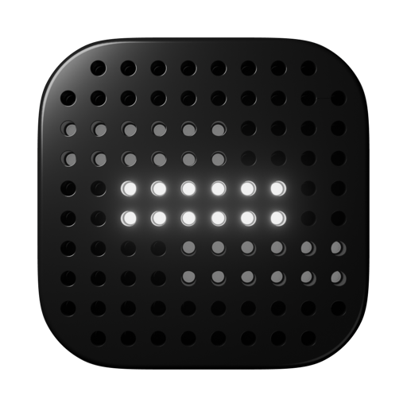

<div align="center">



# Klar

**A calm, fast web browser for the Mac.**<br>
An alternative to Arc, native from top to bottom: SwiftUI and AppKit on Safari's WebKit engine.

[](#install)
[](https://www.swift.org)
[](https://webkit.org)
[](LICENSE)

[**Download**](https://github.com/itsnwa/klar/releases/latest) · [Features](#features) · [Shortcuts](#keyboard-shortcuts) · [Build from source](#build-from-source) · [Contributing](#contributing)

<!-- Screenshot: add docs/screenshot.png, then uncomment the image below.
<br><br>

-->

</div>

<br>

*Klar* is Norwegian for *clear*. It's a browser that keeps out of your way: your tabs live in a sidebar of spaces, everything else is a keystroke away in the command palette, and there's no Chromium, no account and no telemetry underneath.

## Features

### Tabs and spaces

- **Spaces** keep separate sets of tabs, each with its own icon, color and, if you like, its own profile for sign-ins and history. Switch with <kbd>⌃</kbd> <kbd>1</kbd>–<kbd>9</kbd> or a two-finger swipe on the sidebar.
- **Saved tabs and groups** stay in the sidebar. Open tabs sit below them and close on your schedule: at the end of the day, after a day unused, when you quit, or never.
- **Pinned sites** are the sites you use most, as icons at the top of the sidebar, the same in every space and always loaded.
- **Overview**: pinch the sidebar to see your downloads, Reading List, history and every space at once.
- **Split view** puts up to four pages side by side or stacked. Press <kbd>⌘</kbd> <kbd>D</kbd>, or drag a tab onto the page.
- **Every window, every Mac**: all your windows show the same open tabs, and with iCloud on, so do your other Macs.
- **Undo Close Tab** with <kbd>⌘</kbd> <kbd>Z</kbd> brings a tab back with its history.

### Command palette and search

- **One palette for everything**: <kbd>⌘</kbd> <kbd>T</kbd> to search or go to a site, <kbd>⌘</kbd> <kbd>K</kbd> for actions on the tab you're on.
- **Site shortcuts** search a site directly: type `yt cats` for YouTube. Pick from popular sites or add your own.
- **Popular sites** are suggested as you type their address, even before you've visited them.
- **Any search engine**, including one of your own.

### Privacy

- **No telemetry, no analytics, no account.** Klar has no server of its own: it checks its latest release on GitHub for new versions.
- **Private tabs** (<kbd>⇧</kbd> <kbd>⌘</kbd> <kbd>T</kbd>) stay out of your history and forget their cookies and sign-ins once the last one closes.
- **Profiles per space** keep work and personal sign-ins, cookies and history apart.
- **Website settings** from the gear in the address bar: camera, microphone and location per site, the connection and its certificate, zoom, and clearing a site's data.
- **Tracking parameters** such as `utm_source` and `fbclid` are removed from the links Klar keeps.
- **Your data stays yours**: sync goes through your own private iCloud database, and passwords live in the macOS keychain.

### Made for the Mac

- **Liquid Glass**, tinted with your space's color.
- **Passwords and verification codes** from Apple's Passwords app, alongside Klar's own keychain-backed passwords, and autofill from your card in Contacts.
- **iCloud sync** for spaces, saved tabs, pinned sites, open tabs, settings, extensions and site permissions, with passwords in iCloud Keychain.
- **Reading List** shared with Safari's.
- **Picture in Picture** from the live preview of a video playing in another tab, right in the sidebar.
- **Background tabs stay ready**: Klar only frees their memory when your Mac runs low.

### Coming from another browser

- **Import from Arc and Dia**: spaces, pinned tabs, folders and favorites, in setup or from Settings › Import.
- **Chrome Web Store extensions**: add them from the store, or bring over the ones you use in Chrome, Arc, Brave, Edge or Dia, and pin their buttons to the address bar.

### AI, if you want it

Nothing is sent anywhere until you ask, and Klar has no AI service of its own: it uses the tools already on your Mac.

- **Ask about the page** from Find (<kbd>⌘</kbd> <kbd>F</kbd>), with the Claude or ChatGPT subscription you already have through Claude Code or Codex, or a local model with Ollama. Answers quote the page, and a quote takes you to the passage.
- **Explore with AI** from <kbd>⌘</kbd> <kbd>K</kbd> finds sites like the one you're on, where people discuss it, or other sources on it, laid out as a page of cards.

## Keyboard shortcuts

| Shortcut | Action |
| --- | --- |
| <kbd>⌘</kbd> <kbd>T</kbd> | New tab: search or go to a site |
| <kbd>⌘</kbd> <kbd>L</kbd> | Command palette |
| <kbd>⌘</kbd> <kbd>K</kbd> | Actions for the tab you're on |
| <kbd>⇧</kbd> <kbd>⌘</kbd> <kbd>T</kbd> | New private tab |
| <kbd>⌘</kbd> <kbd>S</kbd> | Show or hide the sidebar |
| <kbd>⇧</kbd> <kbd>⌘</kbd> <kbd>O</kbd> | Overview of all your spaces |
| <kbd>⌃</kbd> <kbd>1</kbd>–<kbd>9</kbd> | Switch spaces |
| <kbd>⌥</kbd> <kbd>⌘</kbd> <kbd>↑</kbd> / <kbd>↓</kbd> | Previous or next tab |
| <kbd>⌘</kbd> <kbd>D</kbd> / <kbd>⇧</kbd> <kbd>⌘</kbd> <kbd>D</kbd> | Split side by side or stacked |
| <kbd>⌃</kbd> <kbd>⌘</kbd> <kbd>←</kbd> <kbd>→</kbd> <kbd>↑</kbd> <kbd>↓</kbd> | Move between split panes |
| <kbd>⌘</kbd> <kbd>F</kbd> | Find on the page, or ask about it |
| <kbd>⌘</kbd> <kbd>Z</kbd> | Undo Close Tab |

## Install

Klar runs on **macOS 26 Tahoe or later**, on a Mac with **Apple silicon**.

1. Download `Klar-<version>.dmg` from the [latest release](https://github.com/itsnwa/klar/releases/latest).
2. Open it and drag Klar to Applications.
3. To make Klar your default browser, choose it in **Settings › General › Default Browser**.

Klar keeps itself up to date: it downloads new versions in the background and installs them when you restart it or quit.

## Build from source

You'll need a Mac with Apple silicon, **macOS 26** and **Xcode 26**.

```bash
git clone https://github.com/itsnwa/klar.git
cd klar
cp Config/Local.xcconfig.example Config/Local.xcconfig
open Klar.xcodeproj
```

Klar is signed with its own Apple developer team, so give your build your own signing first, in `Config/Local.xcconfig`: your Team ID (a free account works), or, without one, the lines that sign it to run on your Mac only. Git ignores that file.

Xcode fetches Klar's one dependency, [Sparkle](https://sparkle-project.org), on first open. Pick the **Klar** scheme and press <kbd>⌘</kbd> <kbd>R</kbd>.

Your build has a bundle identifier of its own and leaves out what only Klar's team can sign for (`Klar/Klar-Local.entitlements`), so iCloud sync and accounts from Apple's Passwords app are unavailable in it. To try sync with a CloudKit container of your own, list it in an entitlements file of yours and set `KLAR_ICLOUD_CONTAINER` to it.

Debug builds never check for updates, sync with CloudKit's development environment, and keep Xcode's console to Klar's own log messages.

## Project layout

| Path | What's there |
| --- | --- |
| `Klar/Features/` | One folder per feature: Browser, Sidebar, TabManagement, CommandPalette, Find, Extensions, CloudSync, PasswordManager and more, each with its views, components and managers |
| `Klar/Core/` | Shared managers, models, UI components and utilities, such as logging and keyboard handling |
| `Config/` | Klar's signing (`Klar.xcconfig`), and the example for your own (`Local.xcconfig.example`) |
| `Klar/ReleaseNotes.json` | Release notes, shown on Klar's What's New page and in the update feed |
| `scripts/` | Generators for bundled data (brand icons, emoji catalog, popular sites, onboarding sounds) and the Debug log filter |
| `docs/` | Where each brand icon comes from, and its license |
| `ship` | Builds, notarizes and publishes a release |
| [`CLAUDE.md`](CLAUDE.md) | Detailed architecture notes: windows, tabs, the sidebar, sync, WebKit and how they fit together |

## Releasing

Releases are made with `ship`, which bumps the version, archives with Developer ID signing, notarizes a DMG and publishes it as a GitHub release, which every copy of Klar updates from:

```bash
./ship patch             # or minor, major
./ship patch --silent    # installs on quit, with no update card or What's New tab
./ship --no-publish      # just the notarized DMG, in build/ship/
```

It needs the maintainer's signing identity, notary profile and Sparkle signing key, and the GitHub CLI logged in, set up as described at the top of the script.

## Contributing

Bug reports, ideas and pull requests are welcome. For a bug, include your macOS version, Klar's version (in **Settings › General**) and the steps that lead to it.

When you send a pull request:

- **Keep it focused** on one change, and replace code you improve rather than adding a second version beside it.
- **Follow the concurrency model**: Swift 6 language mode with the main actor as the default isolation. What runs off the main thread is marked `nonisolated`.
- **Log with Klar's `Logger`** (`logDebug(.sidebar, "…")`) rather than `print`.
- **Add new files to the Xcode project**, or they won't be compiled.
- **Write a release note** for anything people will notice, in the `"unreleased"` entry at the top of `Klar/ReleaseNotes.json`, as one sentence for people browsing with Klar.

## Credits

- **[Sparkle](https://sparkle-project.org)** delivers Klar's updates.
- **[Simple Icons](https://simpleicons.org)** draws the brand icons you can give a group or space. [docs/brand-icons.md](docs/brand-icons.md) lists each one's source and license.
- **Emoji data** comes from the [Unicode Consortium](https://unicode.org/emoji/), and the popular sites list from the [Chrome UX Report](https://developer.chrome.com/docs/crux) ranked by [Tranco](https://tranco-list.eu).

In the app, **About Klar › Acknowledgements** lists them with their licenses.

Brand names and logos, including the AI and search providers' in Settings, are trademarks of their owners. Showing them doesn't imply any affiliation with or endorsement by those owners.

## License

Klar is free software, licensed under the [GNU General Public License v3.0](LICENSE): you can use, study, change and share it, and anything you distribute that's built on it must be under the same license, with its source.

The brand icons keep their own licenses, listed in [docs/brand-icons.md](docs/brand-icons.md). The Klar name and app icon aren't covered by the license: if you distribute a modified version, give it a name and icon of its own.

<br>

<p align="center"><sub>Made in Norway by <a href="https://github.com/itsnwa">itsnwa</a></sub></p>
